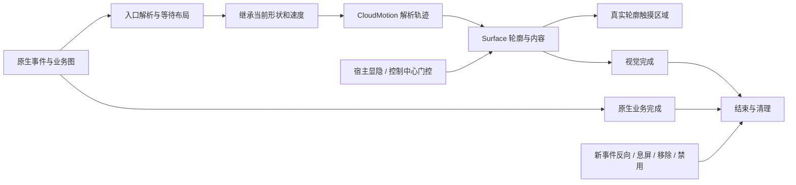

# 流体云动画、逻辑链与性能复查

2026-10-22。范围是流体云相关 Hook、动画引擎、内容绘制、材料、触摸与生命周期，共 25 个 Cloud 源文件（包含本次删除的旧曲线文件）。未修改独立 App 设置界面。用户已手动测试文字/图标防颤抖版，并要求停止真机复测；本轮后续验证均在本机执行，未再次操作手机。

## 审查结论

已完成源码审查并修复四处可复现的问题，清理废弃动画实现与失效测试目标。源码与自动回归通过。审查不构成对最终 APK 的新增真机观感、GPU 耗时或帧率认证。

| 严重程度 | 发现 | 修复与依据 |
| --- | --- | --- |
| P1 | 息屏/源视图移除后，活动 Motion 依赖下一次显示 tick 才发现 Surface 已销毁；息屏可能停止 tick，延迟释放图和监听器 | `CloudMorphHook.forget` 立即结束该容器的视觉所有者。回归验证 clock、active、windows、running、容器映射和原生动画监听器均被释放；晚到的原生结束不重启视觉动画 |
| P2 | 匀速的宿主显隐动画在静止点反向时，将明确的零速度当作首次起步，注入约 478px/s 的宽度速度（240px 示例） | `CloudVisibilityState.beginHost` 保留零切线；首次起步仍按既定匀速规则。新增反向初始速度和第一微步断言，修复前失败、修复后通过 |
| P2 | 同一帧多次替换内容，尚未显示的 incoming 图层不断变成 outgoing 并保留原生 View | 在选择新来源时清理“透明度为零且透明度速度为零”的旧图层。保留有可见像素或淡出动量的图层。1000 次未采样替换仅保留 2 层，透明度总和仍为 1 |
| P2 | 卡片已稳定时，`CloudCardRoster.sync` 每次仍分配列表、映射和结果对象 | 检查原生 wrapper 顺序与绑定内容身份，稳定时复用不可变结果。变化时仍走原有完整差异路径；删除、重排、回收复用、空绑定、空项与重复项均有回归 |
| P2 | 单测验证的 `CloudMorphTiming` 已无生产调用，测试通过不能证明当前曲线正确 | 删除旧实现，单测直接调用运行中的 `CloudMotion`，覆盖端点、回弹界限、半程时间及时间缩放 |
| P3 | 旧方案遗留了未使用的帧插值、轨迹镜像字段、空清理函数和无用参数 | 删除 `mix(Frame,Frame,...)`、Motion 的重复 trajectory 字段、空 `releaseClips()` 和 frame 的 primary 参数；保留真正供绘制使用的 Surface trajectory |

上述四项新增行为回归均先在修改前版本失败，再在修改后版本通过。日志位于 `.local/cloud-audit-20261022/`。

## 动画与事件链覆盖

原生业务图继续决定内容创建、窗口挂载、服务状态与业务结束。独立视觉 Motion 接管形状和运动；Surface 管理呈现、内容与触摸。没有取消或暂停原生业务动画来强行匹配视觉时长。

| 路径 | 检查点与自动覆盖 |
| --- | --- |
| 前台进入胶囊 | APP_TO_CAPSULE / WITH_NONE，预留容器避免提前露出终点；原生宽度扩张只接管一次；晚布局保留事件进度 |
| 胶囊出现、更新、消失 | CAPSULE_APPEAR、WIDTH_CHANGE、SEIZE、BUBBLE_SWITCH、UPDATE_DATA、DISAPPEAR；消失只折叠宽度，保持圆端与中心 |
| 普通卡片展开/收起 | CAPSULE_TO_CARD、CARD_TO_CAPSULE、BY_INTERRUPT；实际位置、速度接续；原生晚结束不冻结视觉或误隐藏新卡片 |
| 即时卡片与带空白路径 | 大/小即时卡片的打开、关闭及 WITH_BLANK；正确选择主窗口/浮动容器，保留原生挂载流程 |
| 多卡片 | 首卡立即响应、后续卡片跟随当前首卡；删除与重排更新原生绑定；已变更绑定不会被稳定缓存吞掉 |
| 内容切换 | 独立内容位移及透明度，A→B→A 中断连续；隐藏零权重来源及时释放；不导入原生外壳宽度弹簧的二次缩放 |
| 文字与图标 | 原生实时内容保持更新；只对实际变化字符做效果；场景 reveal 与字符更新分别管理；清理文字租约及回调 |
| 月牙 | 原生图案随当前胶囊边缘定位；独立透明度连续；输入区域包含可见月牙；不导入宿主宽度片段的偏移 |
| 控制中心、宿主显隐 | host/business/shade 门控分别处理；业务迟到的 show 不能覆盖控制中心隐藏；反向继承零切线和边界夹取后的真实速度 |
| 触摸与外部关闭 | 根据真实轮廓发布 Region；打开时等待 Body 输入提交再接管原生窗口；收起立即释放 Body 外部捕获，原生透明窗口维持禁用直到隐藏 |
| 应用跳转、息屏、移除与禁用 | 原生跳转不被残留窗阻挡；视觉所有者立即释放；时长缩放为零退回原生行为；晚回调不能复活旧会话 |
| 圆角与材料 | 胶囊圆端与卡片 G2 连续过渡；轮廓、装饰和原生 blur 使用相同呈现形状；配置失效时恢复宿主参数 |
| 锁屏/通知模板/SDK 动效 | 宿主原生动画保留；颜色与几何 Hook 的临时写入在 after 边界恢复，避免重复缩放宿主 alpha；不将状态栏独立 Surface 套入锁屏原生 mini 卡片 |

审查同时检查了可访问节点、输入坐标转换、屏幕生命周期、receiver/监听器注销与异常清理边界。TalkBack、真实 GPU 与固件反射兼容性仍属于设备验证边界，本轮未新增相关实测结论。

## 性能开销与取舍

### 已测量的稳定列表辅助路径

同一机器、同一 JDK 17，3 张卡片，预热 100000 次，每轮 240000 次，3 轮。通过 ThreadMXBean 测分配；结果写入 volatile 防止整个调用被消除。

| 指标 | 修改前 | 修改后 |
| --- | --- | --- |
| 分配/次 | 488 / 488 / 488 bytes | 0 / 0 / 0 bytes |
| 耗时/次 | 118.0 / 100.0 / 81.7 ns | 11.4 / 12.2 / 10.3 ns |

这仅测 `CloudCardRoster.sync` 的稳定路径，不包含宿主 getter、外部过滤列表、Android View、绘制和 GPU；不能据此计算最终帧率。变化路径仍会分配不可变差异快照。可使用 `scripts/check_effects.py --only CloudCardRosterCheck --benchmark` 重跑性能探针。

### 保留的性能策略

- `CloudMotion` 使用解析值，不随帧率数值积分；同一进度复用位置/速度采样，六个通道共享指数与三角函数。
- 显示窗口尺寸保持稳定；轮廓子视图同步更新尺寸，避免每帧再次请求整个窗口的布局。原生 G2 轮廓及材料需要真实尺寸，直接缩放整张卡片会连文字和圆角一起拉伸，因此不做这种替换。
- 触摸轮廓按呈现几何、按压和窗口边界缓存；状态门控和多卡片 union 仍即时计算。相同 Region 不重复提交。
- 不透明端点直接绘制，短暂交叉淡化才使用离屏 alpha layer。文字稳定时绕过字符 RenderNode 效果；模糊效果缓存复用。
- 保留宿主真实内容绘制，避免卡片动作、计时值或媒体内容停留在截图中。

### 仍存在的开销边界

- native `measure/layout`、G2 路径、Region 光栅化、原生背景模糊和文字模糊仍有实际成本；本轮没有把这些成本描述为零。
- 原生树和独立窗口都可触发 pre-draw。几何/材质/轨迹已有相同帧缓存，仍需执行输入门控和源内容观察，以免漏掉原生事件。未在缺少真实渲染证据时直接删掉观察路径。
- 有可见像素或透明度速度的 outgoing 内容必须保留到完成；本次仅删除完全不可能贡献像素的图层，不采用粗暴的固定 2 层上限。

## 验证与交付

- Debug、Release 构建成功。
- 125 项 JUnit：失败 0、错误 0、跳过 0；曲线单测已切换为生产 CloudMotion。
- 全量 `scripts/check_effects.py` 通过，其中包括 42971 条连续轨迹、2984 条视觉对象生命周期、415 条内容切换，以及多卡片、触摸门控、圆角和原生材料回归。
- `scripts/check_cloud_text_renderer.py`：40 项通过。
- `git diff --check` 通过。
- 测试夹具会有预期的“宿主类不可用”等诊断；以完整进程退出码与回归断言为依据，不将它们当作手机运行日志。

签名包：`dist/thunder-cloud-animation-audit-20261022.apk`。

SHA-256：`080d7fbba3c21355d2493d3a1b293a0d07a999ea96f956b8dfc3c2529a054f2a`。

构建清单：`.local/cloud-audit-20261022/manifest.json`。本轮未安装或重载该审核优化包；手机仍运行用户已手动测试的 `thunder-cloud-content-stable-20261022.apk`。两者明确区分，避免把旧版本的手测结果当作新包验证。
